<p align="center">
  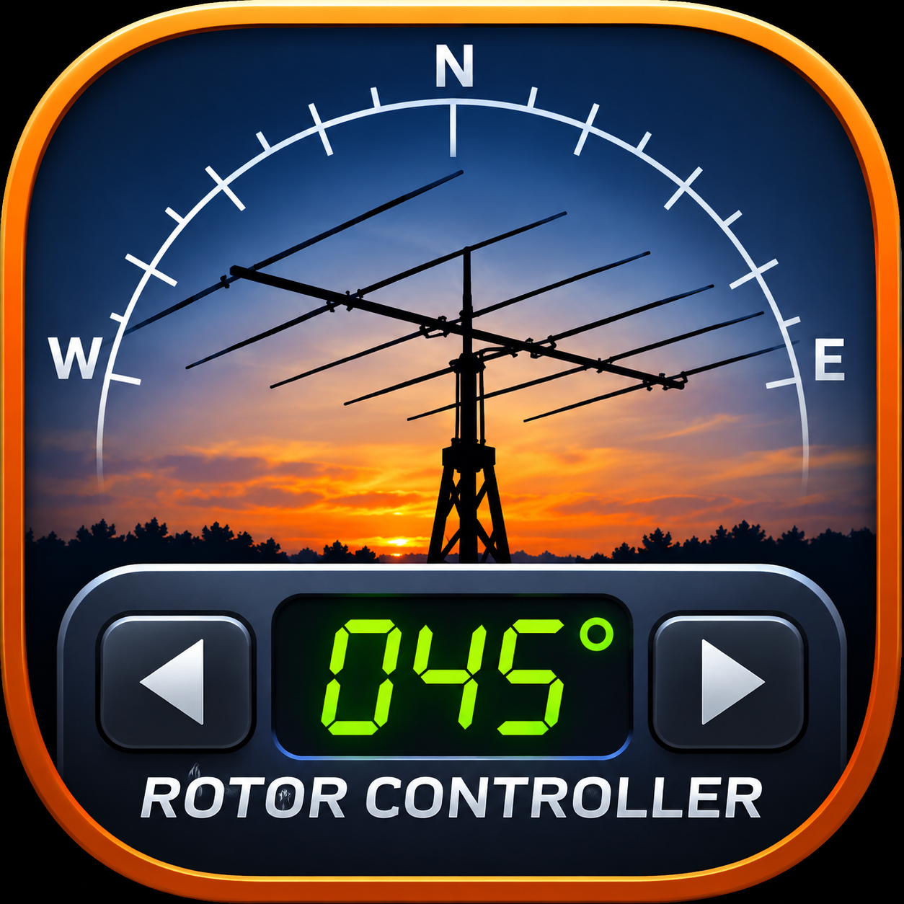
</p>

<h1 align="center">Rotor Controller</h1>

<p align="center">
  A modern, cross-platform (Windows, Linux, macOS) antenna rotor controller written in Rust.<br>
  Version 1.0.1-beta
</p>

<p align="center">
  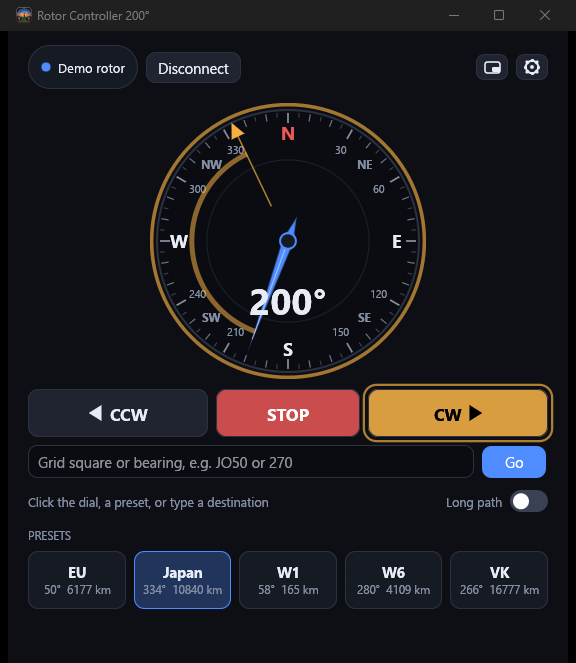
  &nbsp;
  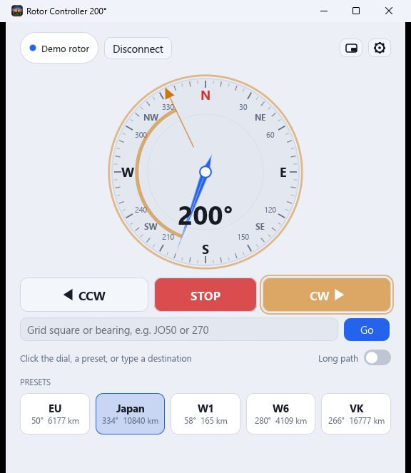
</p>

## Features

- **Full and compact views.** The full view has a compass rose with eight directions (click it to turn), CCW / STOP / CW,
  a go-to field that accepts a Maidenhead grid square or a bearing, a long-path switch and the preset buttons. The compact view
  is a small fixed-size window with the rose, the controls and the presets.
- **5 preset buttons** with your own labels. Each turns the antenna toward a grid square, computed from your own grid square.
  Right-click a preset to edit it.
- **Overlap handling** for 450 degree rotors such as the Yaesu G-800DXA: the program picks the way round that stays within the
  rotor's travel and shows "(overlap)" past 360 degrees.
- **Hold-to-run jog buttons**; the CW / CCW buttons and the dial ring pulse while the antenna is moving.
- **Optional elevation axis** (where the protocol supports it) with a clickable elevation bar.
- **Light and dark themes**, kilometers or miles, optional always-on-top.
- **Auto-connect and reconnect** to the serial port.
- **Guided calibration** for the Yaesu GS-232B (zero point, full scale, rotation range, north/south start) and a software
  span correction for interfaces whose full scale reads wrong.
- **Sharing:** a built-in rotctld-compatible TCP server lets loggers and other programs steer the rotor.
- **Update check** against this repository's releases (can be turned off); on Windows the executable can replace itself.
- **Demo mode** (`--demo`) simulates a rotor, so everything can be tried without hardware.

### Supported protocols

| Protocol | Status |
| --- | --- |
| Yaesu GS-232 (G-800DXA through a USB-232B) | Azimuth; azimuth and elevation (G-5500 and others). Aimed at real hardware. |
| Easycomm II | Built from the published description; untested on hardware. |
| SPID Rot2Prog / MD-01 / MD-02 | Untested on hardware. |
| Prosistel D | Untested on hardware. |
| Hy-Gain DCU-1 / Rotor-EZ | Azimuth only; untested on hardware. |
| Hamlib rotctld (network client) | Untested on hardware. |

## Screenshots

<p align="center">
  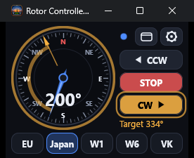
  &nbsp;
  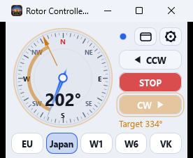
  &nbsp;
  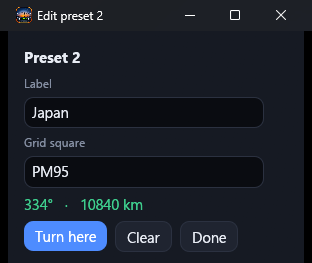
</p>
<p align="center"><em>Compact view in both themes, and the preset editor (right-click a preset).</em></p>

### Settings

The gear button opens the settings window, with one page per topic:

<p align="center">
  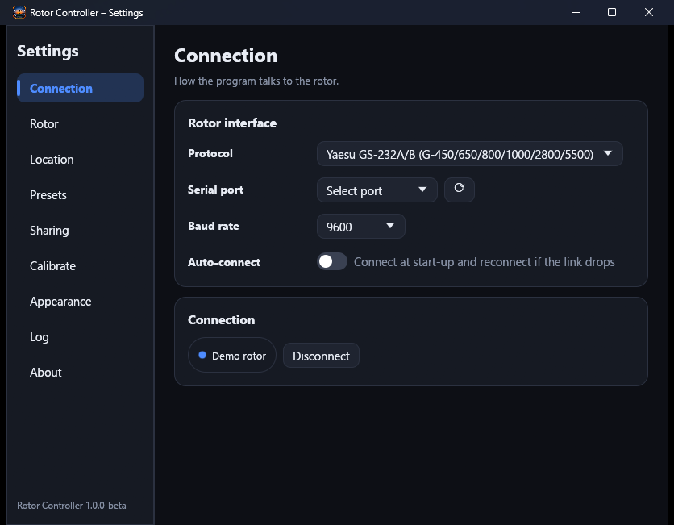
  &nbsp;
  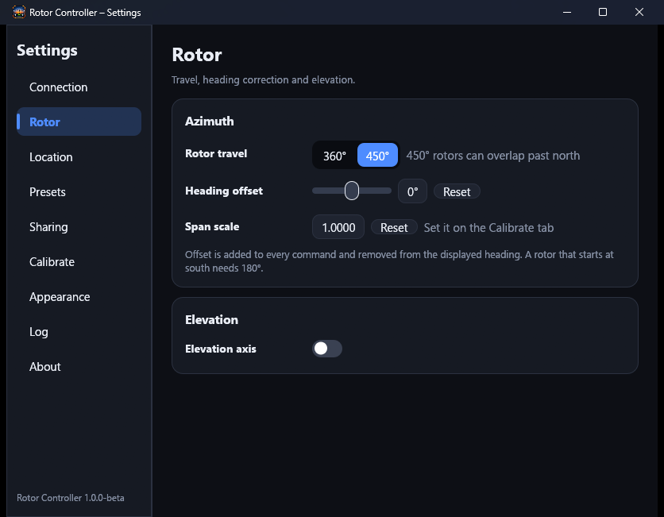
</p>
<p align="center">
  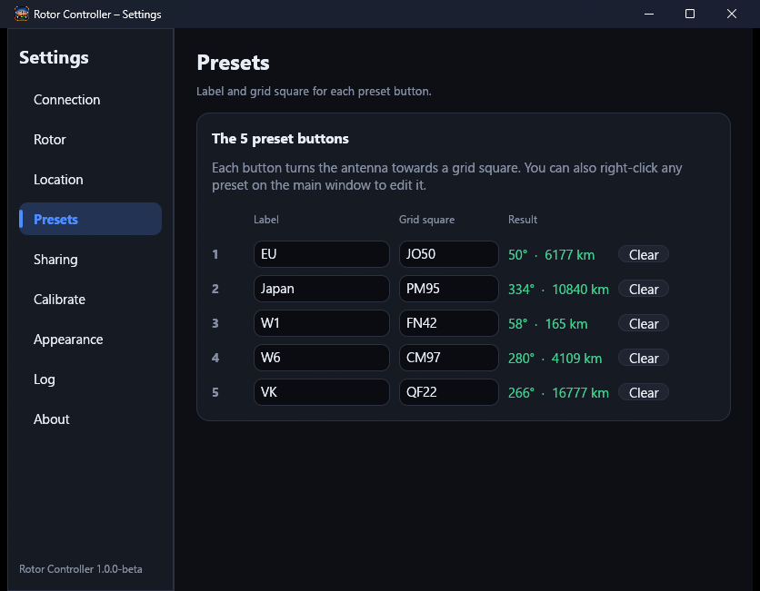
  &nbsp;
  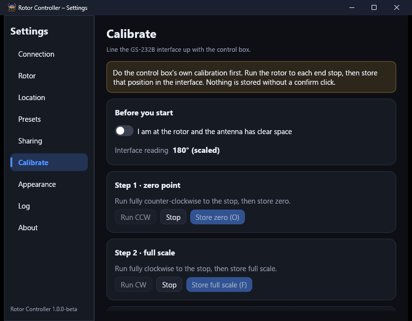
</p>
<p align="center">
  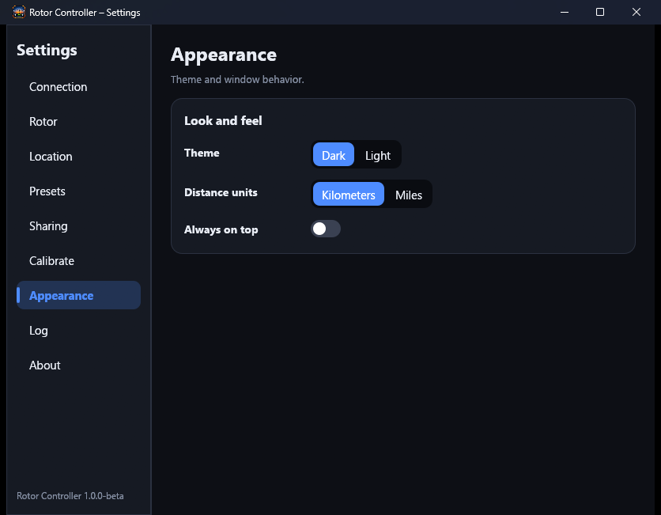
  &nbsp;
  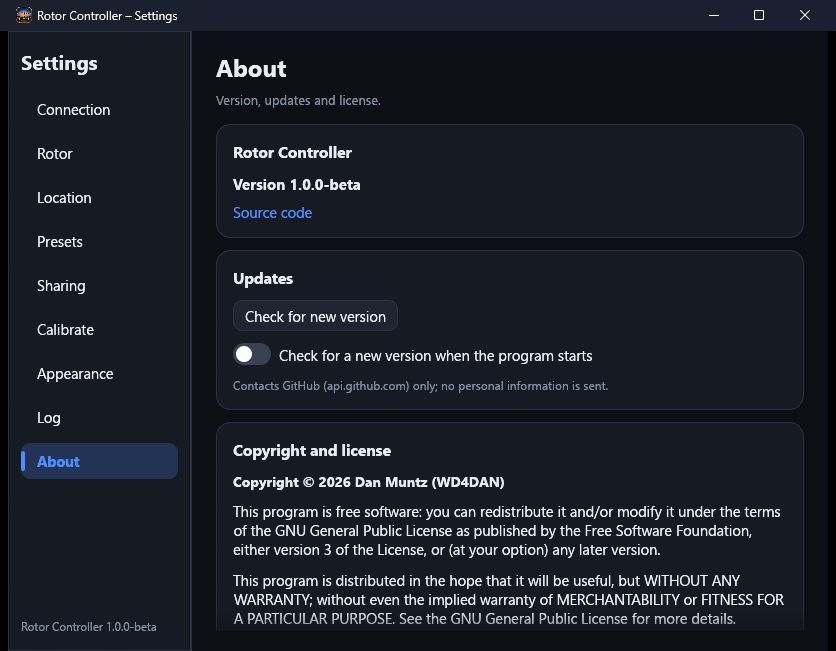
</p>
<p align="center">
  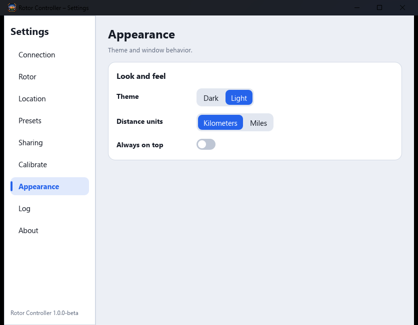
</p>

## Getting started

1. Start the program, open **Settings → Connection**, choose the protocol and serial port (9600 baud for the Yaesu) and press
   Connect. After that it connects by itself at start-up.
2. In **Settings → Location**, enter your own grid square so the presets know where to point.
3. In **Settings → Rotor**, set the rotor travel (450 degrees for the G-800DXA) and, if the heading is off by a fixed amount, an
   offset. A Yaesu 450 degree rotor starts at south, so it needs an offset of 180.
4. Edit the presets with a right-click.

Try it without hardware:

```
rotor-controller --demo
```

## Build

```
cargo build --release
cargo test
cargo clippy --all-targets
```

The result is a single executable (static C runtime on Windows). Linux needs `libudev-dev` plus the usual windowing libraries
(see `.github/workflows/ci.yml`).

## Where settings are kept

Settings are stored as JSON in the per-user config directory (on Windows
`%APPDATA%\rotor-controller\config\config.json`). The window position is kept in `data\app.ron` next to it.

## License

Copyright © 2026 Dan Muntz (WD4DAN).

This program is free software: you can redistribute it and/or modify it under the terms of the
GNU General Public License as published by the Free Software Foundation, either version 3 of the
License, or (at your option) any later version. It is distributed in the hope that it will be useful,
but WITHOUT ANY WARRANTY; without even the implied warranty of MERCHANTABILITY or FITNESS FOR A
PARTICULAR PURPOSE. See the [LICENSE](LICENSE) file or <https://www.gnu.org/licenses/gpl-3.0.html>.
